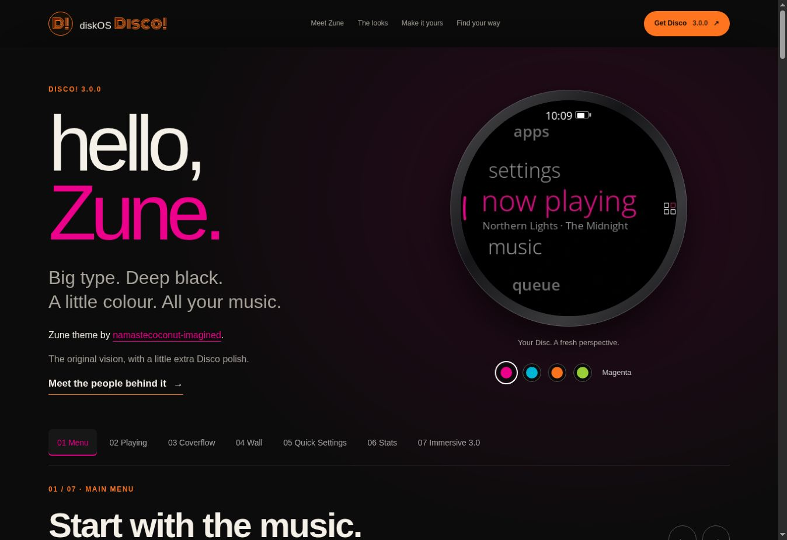

# Zune integration — Disco! 3.0.0

The Zune integration is included in Disco! 3.0.0. See [the release](https://github.com/zmd22/diskos-disco/releases/tag/v3.0.0) for downloads.

- [Theme guide and acknowledgements](themes/zune.md)
- [3.0.0 release notes](releases/v3.0.0.md)
- [Validation and remaining device checks](RELEASE_3.0.0.md)
- [Interactive website source](index.html)

Zune is by **[namastecoconut-imagined](https://github.com/namastecoconut-imagined/diskos-disco-zune/commits?author=namastecoconut-imagined)**. The original theme’s visual direction and implementation form the foundation; zmd22 adapted it to Disco’s shared features and polished readability and controls. Based on original commit `13821d6d024d6dfc90d6ac505ca7e4af94f4e256`.

Home, Music, Immersive 3.0, library and album views, search, queue, settings, Quick Settings, radios, working modes, battery, lock screens, EQ and apps follow Zune. Shared Wall/Coverflow, larger text, configurable main-icon gestures, modal volume adjustment and guarded USB-C output are included. The fork’s unrelated power-button, framebuffer, boot and compiler-policy changes remain excluded.

Website images are fresh host LVGL renders, not physical device captures. The reproducible generator is `tools/render-zune-site.py`; it uses illustrated synthetic artwork and sample history. See `docs/site/README.md` before generating fixtures.

Open Sans keeps its bundled SIL Open Font License. This is an unofficial fan theme, not affiliated with Microsoft, FiiO or Snowsky.

## Website preview

## Appearance in 3.1.0

Display > Light / dark offers Dark, Light and Auto for Zune. Auto is dark from 19:00 to 07:00 and light otherwise, using the device clock and switching while the screen is off. Light uses a white canvas, black type and the selected accent.
