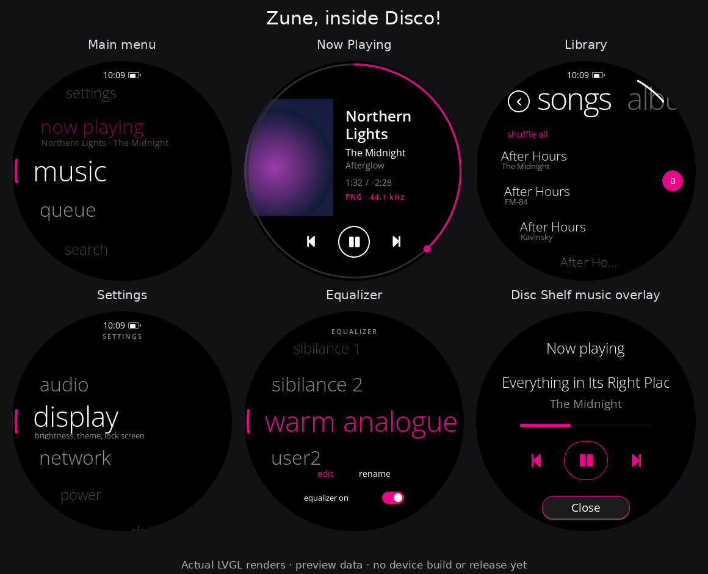
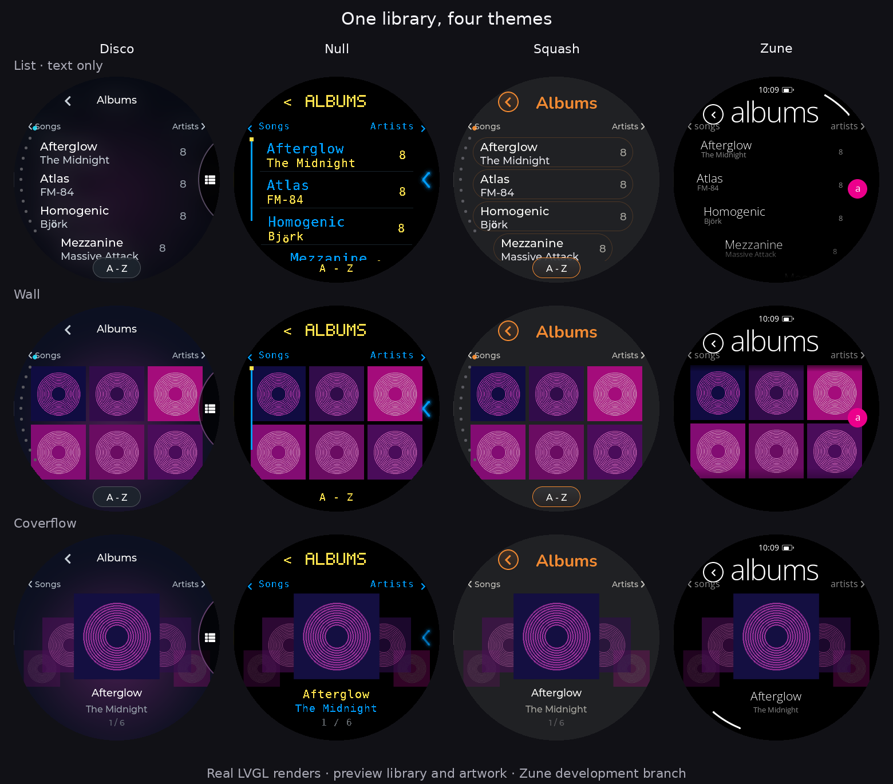
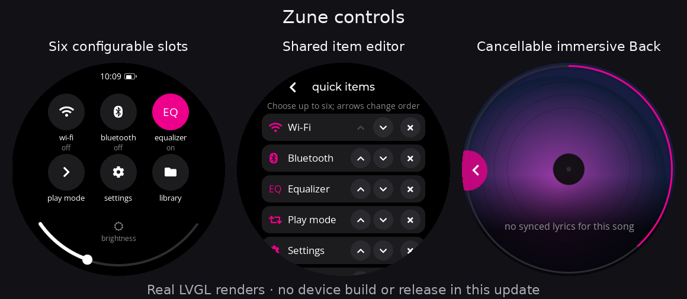

# Zune theme integration preview

Optional Zune-inspired styling on the 2.7.0 codebase, including the tested Disc Shelf playback overlay and copy navigation guard. This is development source, not a published firmware release.

## Scope

Home, music, immersive playback, library, album/artist views, selection, letter pickers, search, queue, settings, Quick Settings, Wi-Fi, Bluetooth, modes, battery, screensaver, equalizer and apps use Zune styling. Disc Shelf retains its landing screen, download handling and music controls. The five existing working modes remain unchanged.

The theme uses lowercase Open Sans, magenta accents, curved lists and a dark canvas. Appearance is fixed dark with an explanation in settings. Menu hold uses the existing configurable actions, including Shuffle!. Row swipes retain multiselect; library category swipes are restricted to the header.

## Local legibility preview (not published)

Zune raster fonts increase by 1px for the smallest text, 2px for body/headline cuts, and 3px for large numerals. Light text gains a little weight; the drawn logo stays unchanged. The source font and generator are included for reproducibility. No runtime bitmap scaling or polling is added. Settings rows gain 4px to fit their larger label/value pairs.

The library header returns to the original fork’s pivot presentation: a large category with the next title peeking from the right, switching with the original 220/260ms list/header slide. The same presentation now uses Disco, Squash and Null’s own type and colours. Header swipes stay separate from row-selection swipes; Back and the album-view preference remain available. This supersedes the separate previous/next arrow row in the shared-controls pass below.

34 host checks/render cases passed in this preview, covering category switching in all four modern themes and album modes, Zune screens and QS/immersive actions, and text-row selection in all four themes. Awaiting visual review and device testing; no branch push or binary packaging yet.

## Shared library and controls update

All work remains on `integration/zune-theme`; main and release tags are untouched.

- Immersive: left-edge Back stays available with scrubbing off or on. Feedback follows the finger; reverse the drag before release to cancel. A normal tap still reveals Zune playback controls.
- Quick Settings: up to six user-selected actions, using the shared Items editor. Zune keeps its original Wi-Fi, Bluetooth, Gain, Shuffle, Sleep and Modes defaults; EQ and the other shared actions can replace them. Radio/EQ taps toggle, their holds open the full screen. Gain hold opens Audio; other destinations open normally. Copy navigation restrictions remain active.
- Album View: List / Wall / Coverflow for every theme. List is text only; Wall reuses the three-column Zune tiles and bounded thumbnail worker; Coverflow uses Zune’s curved cover geometry in each theme. The old reflected Coverflow presentation is replaced. The former numeric Cover Flow choice (1) now selects Wall; choose Coverflow (2) to use the new carousel.
- Library: swipe the header or tap either adjacent category to cycle Songs / Albums / Artists / Genres. Header Back returns to the library overview. Row swipes remain selection gestures in text lists. The main-menu Albums shortcut respects Album View too.

No new periodic timer is added. Header watching runs only during a held header touch; thumbnails stop doing work when the relevant page is hidden or the display is off.

## Preserve the working firmware

The fork’s USB-C audio routing, power-button changes, framebuffer recovery, boot workarounds, automatic shutdown policy and global compiler optimization changes are excluded. Bluetooth and Wi-Fi backend behavior remains on the current base. No release version, tag, device binary or website release claim changes here.

Thumbnail loading is limited to relevant visible pages, with a 24-entry cache and a sleeping worker off-page or with the display off. Visible clock/rim updates use the existing UI loop rather than extra periodic timers. This reduces unnecessary work; battery life and peak RAM still require device measurement.

## Validation

- Host build and 51 screen fixture renders completed; these are real LVGL renders with preview music and artwork.
- Pointer checks exercised menu navigation, configured Shuffle!, transport, Quick Settings and modal Back handling.
- Disc Shelf overlay, cancellation cleanup and exit guards passed across eight theme/palette combinations.
- Home, music, settings and Quick Settings in Disco, Null and Squash remained pixel-identical to the previous build (12 comparisons).
- Library fixture exercised populated songs/albums/artists/genres, letter grid and row swipe selection.

Host tests do not establish hardware stability. Before release: test long library sessions, all font choices, lock/wake, radio reconnects, immersive seeking, real downloads and playback together, and measure memory/battery on the Disc. Additional font tables increase the compiled binary; no device-size measurement has been made yet.

## Follow-up validation

34 host checks/render cases passed in this shared-controls pass, including header gestures in all seven presets and all three album modes, row-selection gestures in Disco/Null/Squash/Zune, saved QS ordering and EQ/radio actions, and cancelled/completed immersive Back with scrubbing off/on. Disc Shelf playback/exit-guard regression checks passed in all eight palettes.

## Credit

Adapted from namastecoconut-imagined/diskos-disco-zune, commit `13821d6d024d6dfc90d6ac505ca7e4af94f4e256`. Open Sans retains its bundled SIL Open Font License. This is an unofficial fan theme and is not affiliated with Microsoft, FiiO or Snowsky.

## Shared Immersive playback overlay (preview)

Immersive includes the same tap-to-show controls in every theme. The heading, separate title and artist rows, white transport buttons and subtle accent shading follow the active theme. Null uses smaller two-line wrapped names without scrolling; other themes scroll overflowing metadata horizontally. The existing dark scrim remains. Tap again to hide; swipe from the left edge to return, with cancellable gesture feedback. Circular scrubbing hides the controls while adjusting position or volume. Long metadata gets additional reading time before auto-hide.

The overlay uses the existing Immersive timer, updates metadata only while visible, and inherits its screen-off/idle gate. No separate polling timer or worker is added. Host renders and edge-gesture checks cover all seven available presets; device testing remains necessary.

## Null and Zune polish

- Zune Search uses the same magnifier as Squash in Quick Settings; the shared font fallback also covers other Zune screens.
- Zune Music keeps its artwork and transport layout, with a wider, curved-safe metadata column and up to two lines each for title, artist and album. Its footer aligns with the artwork bottom; transport controls have subtle accent shading. Returning from idle restores playback text and sizing, including the same track.
- Null Immersive starts its own existing renderer regardless of the main Now Playing layout. Cover, Vinyl and CD use sharp artwork independently of Null's pixelated Music background. Its controls have a higher heading and smaller, bounded two-line metadata, with alternate-font clearance.
- Immersive clears stale progress when the next track has no known duration.

31 host cases passed, including live rotation, pause/resume, time updates, unknown-duration reset, all Null font choices, modern-theme Back/transport, and Zune search/metadata behavior. No additional worker or periodic timer was added. Device testing remains pending. PRs #19 and #20 are not included; standby and power-button behavior remain unchanged.

## Layout and debug preview

Small menu captions and its clock use a 15px bold cut; outer labels have stronger contrast. All Immersive themes include cached file type, bitrate and sample-rate information. Estimated bitrate is marked with ~; unknown values use --. No periodic timer or worker was added.

Unchanged metadata, QS styles, menu captions and standby clock/artwork avoid redundant writes. Hidden/off loading arcs and hidden standby/Immersive metadata stop animating; Clock Only keeps its concealed song labels stopped. Wrapped Null names no longer continually reset the controls timeout. The expanded Zune Music hit area ignores rim-origin taps and drags.

44 real-LVGL host cases passed. Device battery/frame-rate validation remains pending.

## Typography Quick Settings

Six configurable actions now fill a two-column layout with short labels and explicit state text. The left column stays within the round bezel. Clock and battery percentage use larger text. A 90-degree lower-rim arc controls brightness, with its label inside.

The heading is a scrolling song-title / artist banner: title in white, artist muted. Tap to pause; “paused / resume” replaces the metadata, and tapping resumes. It uses the existing transport path, including its playback restrictions. Empty playback shows “no music”. Scrolling stops when leaving QS or turning the panel off. Existing Wi-Fi/Bluetooth/EQ taps and holds, configurable ordering and Disc Shelf copy restrictions remain.

## Matching utility screens

Working Modes uses five 144x56 text targets in the QS two-column layout. Existing source-switch commands and switching/active feedback are retained; no spinner or new timer is needed.

Search uses larger letters and radial hit regions split into non-overlapping angular sectors. The search caption, Cancel, and result text are larger. EQ Edit/Rename and the on/off caption are larger and grouped more tightly. Shared status rows use the QS-sized clock type and larger battery icons; QS keeps its percentage.

Weather follows the same typography and column spacing: location, current temperature and condition/icon above four forecast cells. Location editing, automatic location and existing fetch scheduling remain unchanged. Forecast labels are reused; missing cells are hidden and long locations truncate within the header.

## Secondary-screen polish and continuous QS header

QS metadata now uses two copies on a linear loop at approximately 56 pixels/second (18 ms/pixel), with no endpoint dwell or reverse animation. Short title/artist strings loop too. The animation stops when QS is hidden or the panel is off. Unchanged playback refreshes do not restart it. Paused and empty states explicitly reset their position and center their complete text, independent of the previous scrolling offset. The existing playback command and track-availability guard remain.

Music uses Semibold 22 for title and Regular 17 for artist (previously 24 and 16). Secondary pivot headings choose a 40/32/28/24 face to fit a bounded 224-pixel area; the Library retains its large category pivot. Settings values and supporting text use Regular 16 with taller rows. Battery descriptions, totals and charge-limit copy are larger and shorter. Debug Access, Last.fm, How To and Up Next reserve body space below the heading. Folder/book metadata, song information, EQ labels, Queue artists and About values are more readable.

Library Small/Medium/Large use 18/21/24-pixel primary text and 12/13/15-pixel detail text, preserving the existing Medium. Playing rows use 17/19/24; compact album tracks use 17/18/21. Large rows grow to fit both lines. The setting also reaches Artists, Genres and Playlists rather than only generic shared lists.

Validation: native host build, theme gates, real LVGL secondary-screen fixtures, QS pause/resume and continuous/hidden scrolling checks, unchanged refreshes, short metadata, six configurable QS actions, keyboard/mode targets, Music metadata layout, and visible library text at all three sizes. Device testing remains pending. No packaged firmware or release change.

## Folder scrolling and wider Music metadata

Folder titles have an explicit full-font line height and follow their row's curved width. They reuse the Library focus watcher: only the visible row nearest screen center (or explicitly focused row) can scroll; other names show ellipses. This prevents LVGL from choosing vertical animation when a label box is shorter than its font. Pushed pages stop the covered Folder list's animations too.

Music artwork moves left from -46 to -82 while retaining its 192-pixel size. The metadata column starts at 122 instead of 158 and has a nominal 224-pixel width (previously 184), narrowed at the round bezel. Two-line title and artist fitting remain. The line under duration uses Immersive's per-track cached format, bitrate and sample rate, including its marked file-size estimate when needed. No new metadata polling or worker is introduced.

Validation includes folder focus changes at three scroll positions, one horizontal title at a time with no vertical offset, full line height, curved width and covered-page stop; Music long names, metadata hit/seek boundaries, technical-line placement and unchanged-update DB-query counts. Before/after renders use identical fixtures. Physical testing remains pending.

### Main icon and modal interactions

Display > Music screen > Zune sets Main icon, Main icon double-tap and Main icon hold independently. The main-menu icon sits at the right edge, vertically centered. Each setting offers 27 shared shortcuts and actions, including Nothing. Defaults are Up Next, Search and Music screen. A hold or double-tap does not also trigger the single-tap action. The unused Now Playing style setting is hidden for Zune.

SD update, error and reset confirmations reserve separate heading, message and button areas. Long messages can be dragged within their viewport. Volume owns the whole touch gesture so adjusting its dial cannot seek or navigate Music underneath it. Immersive uses the shared disc animation when Animations is enabled, and returns to Zune Music.

Single-line marquee labels in Listening Stats, SongSphere and Tune use content height so theme font substitution cannot turn them into vertical marquees. The host audit (`AUDIT_VERTICAL=1 ASSERT_NO_VERTICAL=1`) checks the rendered label offsets and final font height. `ZVOL_CONCEPT=1`, `2` or `3` renders host-only volume proposals; these do not change the shipping volume screen.
